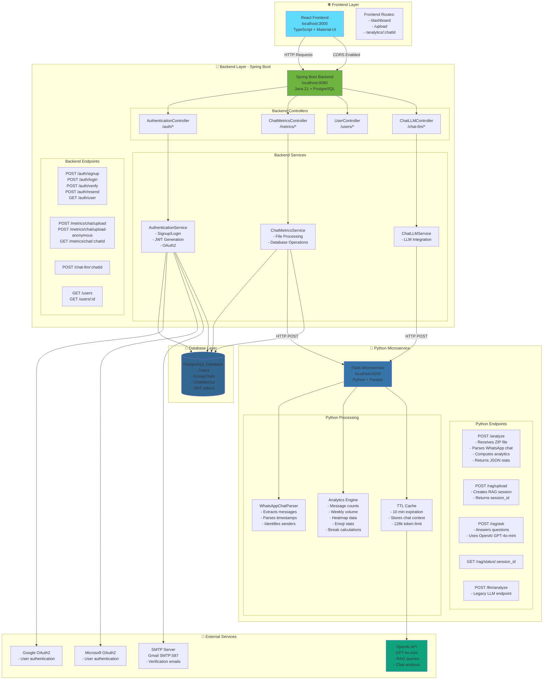
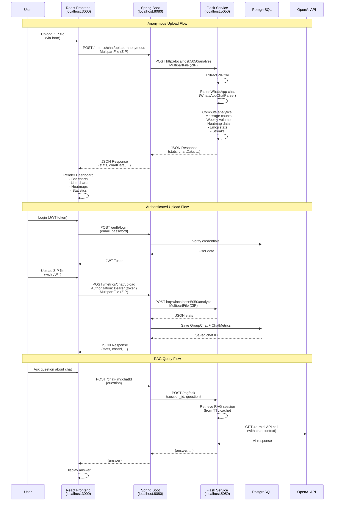

# WhatsApp Analytics - System Architecture Diagram

## 🏗️ Complete System Architecture



## 📊 Data Flow: Upload → Analysis → Display



## 🛣️ Complete Route Map

### Frontend Routes (React Router)
```
/                    → Dashboard (main analytics view)
/upload              → File upload page
/analytics/:chatId   → Specific chat analytics
/login               → Login page
/signup              → Registration page
```

### Backend API Routes (Spring Boot - localhost:8080)

#### Authentication (`/auth`)
```
POST   /auth/signup              → Register new user
POST   /auth/login               → Login (returns JWT)
POST   /auth/verify              → Verify email with code
POST   /auth/resend              → Resend verification code
GET    /auth/user                → Get current authenticated user
```

#### Analytics (`/metrics`)
```
POST   /metrics/chat/upload              → Upload chat (authenticated)
POST   /metrics/chat/upload-anonymous    → Upload chat (anonymous)
GET    /metrics/chat/:chatId              → Get metrics for chat
```

#### Chat LLM (`/chat-llm`)
```
POST   /chat-llm/:chatId         → Ask question about chat
```

#### Users (`/users`)
```
GET    /users                    → Get all users (admin)
GET    /users/:id                → Get user by ID
```

#### OAuth2 (Spring Security)
```
GET    /oauth2/authorization/google      → Google OAuth login
GET    /oauth2/authorization/microsoft   → Microsoft OAuth login
GET    /login/oauth2/code/google         → Google callback
GET    /login/oauth2/code/microsoft      → Microsoft callback
```

### Python Microservice Routes (Flask - localhost:5050)

#### Analytics
```
POST   /analyze                  → Main analysis endpoint
       Query params: enable_rag=true/false
       Returns: Full stats + optional session_id
```

#### RAG (Retrieval Augmented Generation)
```
POST   /rag/upload               → Upload chat for RAG
       Returns: {session_id, title, expires_in_seconds}
       
POST   /rag/ask                  → Ask question
       Body: {session_id, question}
       Returns: {answer, messages_used, expires_in_seconds}
       
GET    /rag/status/:session_id   → Check session validity
```

#### Legacy
```
POST   /llm/analyze              → Legacy LLM endpoint
```

## 🔄 Complete Request Flow Example

### Example 1: Anonymous Upload
```
1. User opens browser → http://localhost:3000
2. User uploads ZIP file via frontend form
3. Frontend sends: POST http://localhost:8080/metrics/chat/upload-anonymous
   Headers: Content-Type: multipart/form-data
   Body: file=chat.zip
4. Backend receives file, forwards to Python:
   POST http://localhost:5050/analyze
   Body: file=chat.zip
5. Python extracts ZIP, parses chat, computes stats
6. Python returns JSON with all analytics
7. Backend returns same JSON to frontend
8. Frontend renders charts and statistics
```

### Example 2: Authenticated Upload with RAG
```
1. User logs in → POST /auth/login
   Response: {token: "jwt_token", expiresIn: 3600000}
2. Frontend stores JWT in localStorage
3. User uploads ZIP → POST /metrics/chat/upload
   Headers: Authorization: Bearer {jwt_token}
4. Backend validates JWT, processes file
5. Backend calls Python: POST /analyze?enable_rag=true
6. Python creates RAG session, returns session_id
7. Backend saves to database, returns stats + session_id
8. User asks question → POST /chat-llm/:chatId
   Body: {question: "Who talks more?"}
9. Backend calls Python: POST /rag/ask
   Body: {session_id, question}
10. Python retrieves cached context, calls OpenAI
11. OpenAI returns answer
12. Python returns answer to backend
13. Backend returns answer to frontend
14. Frontend displays answer
```

## 🌐 Network Configuration

### Ports & IPs
```
Frontend:     localhost:3000  (React dev server)
Backend:      localhost:8080  (Spring Boot)
Python:       localhost:5050  (Flask)
Database:     localhost:5432  (PostgreSQL - default)
```

### CORS Configuration
- Backend allows all origins (`*`) in development
- Frontend can make requests to backend
- Python microservice has CORS enabled for all origins

### Security
- JWT tokens for authenticated requests
- OAuth2 for Google/Microsoft login
- Spring Security filter chain
- Anonymous uploads allowed (no auth required)
- Protected endpoints require JWT in Authorization header

## 📦 Data Structures

### Request/Response Examples

#### Upload Request
```http
POST /metrics/chat/upload-anonymous HTTP/1.1
Host: localhost:8080
Content-Type: multipart/form-data

file: [ZIP file bytes]
```

#### Upload Response
```json
{
  "total_messages": 15234,
  "participants_count": 5,
  "top_user": "John Doe",
  "title": "Family Group",
  "messagesPerUser": [...],
  "weeklyVolume": [...],
  "heatmapData": [...],
  "topEmojisOverall": [...],
  "session_id": "uuid-here",
  "expires_in_seconds": 600
}
```

#### RAG Query Request
```http
POST /rag/ask HTTP/1.1
Host: localhost:5050
Content-Type: application/json

{
  "session_id": "uuid-here",
  "question": "Who talks more?"
}
```

#### RAG Query Response
```json
{
  "answer": "Based on the chat messages...",
  "messages_used": 5000,
  "total_messages": 15234,
  "expires_in_seconds": 450
}
```

## 🔍 Key Components Explained

### Frontend (React)
- **Technology**: React 19, TypeScript, Material-UI
- **Purpose**: User interface for uploading chats and viewing analytics
- **Key Files**: 
  - `Dashboard.tsx` - Main analytics dashboard
  - `BarChart.tsx`, `LineChartByWeek.tsx` - Chart components
  - Reads CSV data (legacy) or uses API responses

### Backend (Spring Boot)
- **Technology**: Java 21, Spring Boot 3.5.6, PostgreSQL
- **Purpose**: API gateway, authentication, database operations
- **Key Features**:
  - JWT authentication
  - OAuth2 (Google/Microsoft)
  - File upload handling
  - Database persistence
  - Proxy to Python microservice

### Python Microservice (Flask)
- **Technology**: Python, Flask, Pandas, OpenAI
- **Purpose**: Heavy computation, chat parsing, analytics
- **Key Features**:
  - WhatsApp chat parsing
  - Statistical analysis
  - RAG (Retrieval Augmented Generation)
  - OpenAI integration
  - TTL caching (10 minutes)

### Database (PostgreSQL)
- **Tables**:
  - `users` - User accounts
  - `group_chats` - Chat metadata
  - `chat_metrics` - Analytics data (JSON columns)

## 🚀 How to Run

1. **Start Database**: PostgreSQL on port 5432
2. **Start Backend**: `cd backend && ./gradlew bootRun` (port 8080)
3. **Start Python**: `cd python_microservice && python3 analytics_service.py` (port 5050)
4. **Start Frontend**: `cd chart_js/my_app && npm start` (port 3000)

## 📝 Notes

- Python microservice is stateless (except RAG cache)
- Backend handles all database operations
- Frontend communicates only with backend (never directly with Python)
- RAG sessions expire after 10 minutes
- Anonymous uploads don't save to database
- Authenticated uploads save to database for later retrieval


