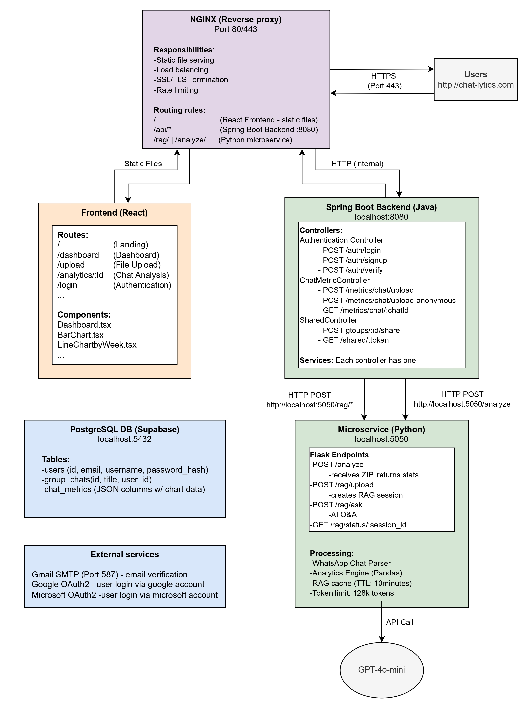

# Chatlytics - WhatsApp Chat Analytics

### https://chat-lytics.com/

## Project Description

Chatlytics is a WhatsApp chat analytics platform that extracts insights from chat conversations. Users can upload WhatsApp chat backups (ZIP or TXT) either anonymously or through authenticated accounts. The system generates statistics such as message activity, usage patterns, emoji trends and conversation behavior.

The platform includes an **AI-driven** question-answering feature powered by a Retrieval Augmented Generation (**RAG**) system using OpenAI GPT models. This allows users to ask natural language questions and receive responses grounded in their actual chat data. Only aggregated statistics are stored in the **PostgreSQL** database, while raw chat data is processed in memory and not persisted.

Chatlytics uses a microservices architecture with a **Spring Boot** backend for authentication and data management, and a Python **Flask** service for chat processing, analytics, and AI tasks. The frontend is built with **React** and the system is deployed on a **AWS EC2** with **NGINX** as a reverse proxy to ensure secure and scalable operation.

## Architecture Overview



The system follows a microservices architecture deployed on AWS EC2:

- **Frontend**: React 19 + TypeScript + Material-UI, served as static files via NGINX
- **Backend**: Spring Boot 3.5.6 (Java 21) REST API with JWT authentication, OAuth2 (Google/Microsoft), and PostgreSQL
- **Python Microservice**: Flask service handling WhatsApp chat parsing, statistical analysis, and RAG (Retrieval Augmented Generation) with OpenAI
- **Database**: PostgreSQL for user data, chat metadata, and analytics storage
- **Reverse Proxy**: NGINX handles SSL/TLS termination, static file serving, and routes API requests to backend services
- **Process Management**: systemd (systemctl) manages backend and Python microservice as background services

## Tech Stack

### Frontend
- **React 19** with TypeScript
- **Material-UI** for components
- **Vite** for build tooling

### Backend
- **Spring Boot 3.5.6** (Java 21)
- **Spring Security** with JWT authentication
- **Spring Data JPA** for database operations
- **PostgreSQL** database
- **Spring Mail** for email verification and password reset
- **Stripe** integration for payments

### Python Microservice
- **Flask** web framework
- **Pandas** for data processing
- **LangChain + OpenAI** for RAG functionality
- **TTL Cache** (10-minute expiration) for RAG sessions

### Infrastructure
- **AWS EC2** for hosting
- **NGINX** as reverse proxy and static file server
- **Let's Encrypt** for SSL certificates
- **systemd** for service management

## Testing the Application

### 1) Run the backend
```bash
cd backend
./gradlew build
./gradlew bootRun
```

### 2) Run the Python microservice
```bash
cd python_microservice
python3 analytics_service.py
```

### 3) Login with dummy user
```bash
curl -X POST "http://localhost:8080/auth/login" \
  -H "Content-Type: application/json" \
  -d '{
        "email": "testuser@example.com",
        "password": "password123"
      }'
```

The response will include a JWT token. Copy this token for the next request.

### 4) Send authorized request
```bash
curl -v -X POST "http://localhost:8080/metrics/chat/upload" \
  -H "Authorization: Bearer <JWT_TOKEN>" \
  -F "file=@/path/to/your/chat_file.zip"
```


### 5) Run Frontend

npm run dev

#### Performs a request which is a post
curl -X POST "http://localhost:8080/metrics/chat/upload-anonymous" \
  -F "file=@/home/duarte33/Documents/WhatsApp Chat - Drenas Espanholas.zip" \
  -v 2>&1 | head -50


## AWS Deployment

The application is deployed on AWS EC2 with the following setup:

### Infrastructure Setup

1. **EC2 Instance**: Ubuntu server hosting all services
2. **Security Groups**: Configured to allow:
   - Port 80 (HTTP) and 443 (HTTPS) for NGINX
   - Port 8080 (Backend API) - internal only
   - Port 5050 (Python Microservice) - internal only
   - SSH access (port 22) for management

3. **Domain & SSL**: 
   - Custom domain configured (chat-lytics.com)
   - SSL certificates managed via Let's Encrypt/Certbot
   - NGINX handles SSL/TLS termination

4. **NGINX Configuration**:
   - Serves React frontend static files from `/dist`
   - Routes `/api/*` requests to Spring Boot backend (port 8080)
   - Routes `/rag/*`, `/analyze/*`, `/metrics/*`, `/llm/*` to Python microservice (port 5050)
   - Handles file upload size limits (`client_max_body_size`)

5. **Service Management**:
   - Backend and Python microservice run as systemd services
   - Services auto-start on server reboot
   - Managed via `systemctl` commands

### Deployment Commands

**Update Backend:**
```bash
cd backend
./gradlew bootJar
sudo systemctl restart backend
```

**Update Python Microservice:**
```bash
sudo systemctl restart python-microservice
```

**Update Frontend:**
```bash
cd chart_js/my_app
npm run build
sudo nginx -t  # Test configuration
sudo systemctl restart nginx
```
