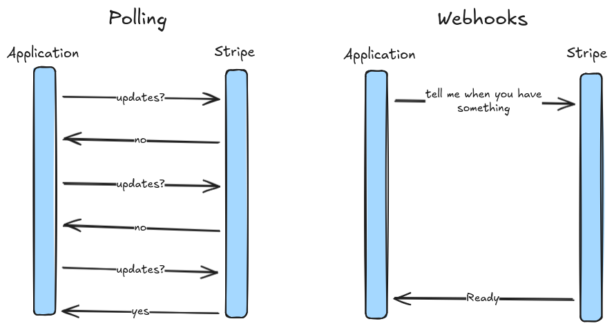
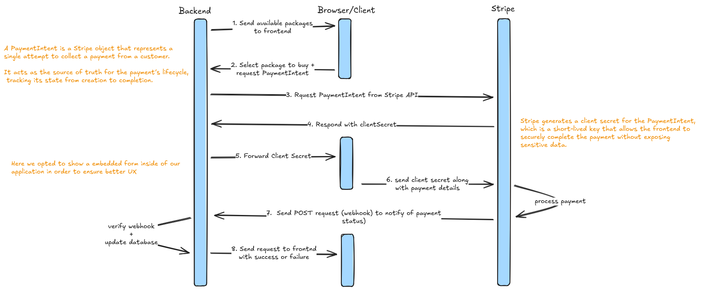

# Payments

## Introduction

Our application uses Stripe to handle payments securely and efficiently. Stripe provides multiple ways to manage payments, the most common being PaymentIntents and Checkout Sessions.

A **PaymentIntent** represents a specific payment we want to collect and handles all aspects of authorization, authentication, and fund capture. It allows us to have fine-grained control over the payment process while keeping the user experience seamless.

A **Checkout Session**, on the other hand, is a hosted Stripe page that wraps a PaymentIntent and provides a full prebuilt checkout flow, including UI for card collection, billing information, and optional shipping. While it simplifies integration, it is less flexible and requires the user to leave our app's native interface.

We chose to use **PaymentIntents** in our application because it allows us to collect payments directly within our app, providing a smoother and more integrated user experience while still leveraging Stripe's secure payment infrastructure.

Here’s your **updated Webhooks section** with a brief comparison to polling and an explanation of why webhooks are better in this scenario:

## Webhooks

Webhooks are a way for Stripe to notify our backend about important events in real time, such as when a payment succeeds, fails, or requires further action. They are critical for keeping our system in sync with Stripe, especially because payment confirmation can happen asynchronously.

### How Webhooks Work in Our Payment Flow

1. **Stripe triggers an event**
   Once a PaymentIntent’s status changes (e.g., payment succeeds or fails), Stripe sends a webhook event to a public endpoint on our backend.

2. **Backend verifies the webhook**
   Each webhook request includes a signature. Our backend checks this signature to ensure the request genuinely came from Stripe and has not been tampered with. This prevents fake or malicious webhook calls.

3. **Backend processes the event**
   After verification, our backend performs the necessary actions:

   * Updating the database to mark the purchase as completed
   * Granting access to purchased packages or subscriptions
   * Triggering any additional business logic linked to the payment

4. **Acknowledging the webhook**
   The backend responds to Stripe to confirm receipt. Webhooks are designed with **at-least-once delivery**, so if Stripe does not receive a confirmation, it will retry sending the event. This ensures that critical events like payment confirmation are not missed.

5. **Frontend decoupling**
   Webhooks decouple payment confirmation from the frontend, allowing the app to handle payments even if the user closes the browser before the payment completes.

---

### Webhooks vs. Polling

* **Polling:** The frontend repeatedly asks the backend “Has the payment succeeded?” at short intervals. This approach can create unnecessary load on both the frontend and backend, introduce delays, and may miss rapid state changes.

* **Webhooks:** Stripe notifies the backend only when a relevant event occurs. This is **real-time, reliable, and efficient**, ensuring that payment updates are processed immediately without repeated requests.

**Why Webhooks are Better Here:**

* Immediate and reliable updates when a payment status changes
* Reduces unnecessary network traffic and server load
* Handles asynchronous scenarios, such as users closing the app before payment completes
* Ensures that critical actions (granting access, updating database) happen even if the frontend is not active

## Payment Flow

### 1. User selects a package to buy

The user clicks on a package or subscription they wish to purchase from within our app.

### 2. Frontend requests a PaymentIntent from the backend

The frontend sends a request to our backend, specifying the package, amount, and currency. The backend creates a PaymentIntent in Stripe.

**PaymentIntent**: Represents the specific payment we intend to collect. It tracks the status of the payment (requires payment method, processing, succeeded, etc.) and handles authentication requirements like 3D Secure.

### 3. Backend returns the PaymentIntent's client secret

The backend calls Stripe's API with the amount, currency, and any metadata. Stripe responds with a PaymentIntent object, which includes the client secret.

Stripe generates a **client secret** for the PaymentIntent, which is a short-lived key that allows the frontend to securely complete the payment without exposing sensitive data. This is forwarded from backend to frontend.

**Client Secret**: Used by the frontend to confirm the payment directly with Stripe. It cannot be used to modify the PaymentIntent and expires after a short time for security.

### 4. Frontend displays the embedded payment form

Instead of redirecting the user to a Stripe-hosted checkout page, our app uses Stripe Elements (or another embedded UI) to collect card details or other payment methods securely within our app.

### 5. Frontend confirms the PaymentIntent with Stripe

Using the client secret, the frontend calls Stripe's API to confirm the payment. Stripe handles all payment validation, fraud checks, and authentication challenges.

### 6. Stripe processes the payment

Stripe authorizes the funds, performs any required authentication, and updates the PaymentIntent status accordingly.

### 7. Stripe sends a webhook to the backend

Once the payment is completed, Stripe triggers a webhook event (HTTP POST) to our backend to notify us of the payment status.

**Webhook Verification**
- The backend verifies the webhook using the signature included by Stripe
- Ensures it comes from Stripe and hasn't been tampered with

**At-least-once delivery**
- Webhooks are retried if not acknowledged
- Ensures the backend receives critical events like payment confirmation

### 8. Backend updates internal records

After verifying the webhook, the backend updates the database to mark the purchase as complete, grant access to the purchased package, or trigger other business logic.

### 9. Frontend shows payment result to user

Based on the webhook confirmation or PaymentIntent status returned to the frontend, the app displays a success or failure message, keeping the user within the app.
