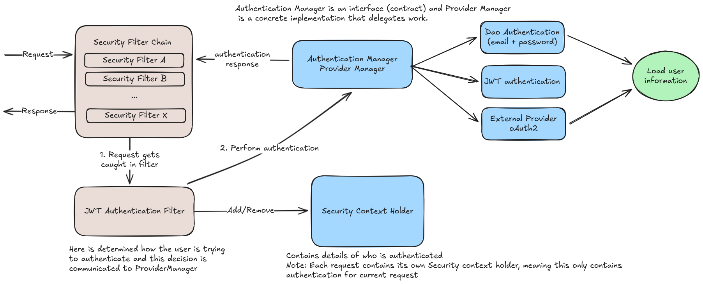
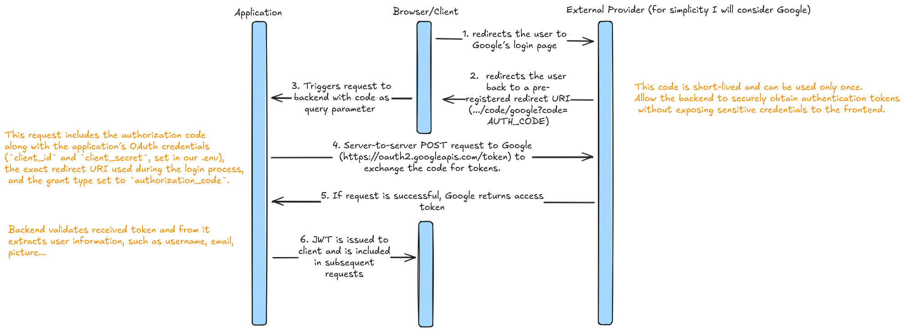

# Spring Security Documentation


This document describes the theoretical background and the practical implementation of authentication and authorization in the application. The implementation is based on **Spring Security**, **JWT**, and optional **OAuth2** providers.

The overall request flow and component interaction follow the standard Spring Security authentication pipeline, illustrated in the diagram below.




## Theoretical Background

### 1. Authentication and Authorization

**Authentication** and **authorization** are closely related but conceptually distinct concerns in application security:

- **Authentication** is the process of verifying a user's identity. It answers: *"Who is making this request?"*
  - Mechanisms: email/password, JWT tokens, OAuth2 providers
  
- **Authorization** determines what an authenticated user is allowed to do. It answers: *"What is this user permitted to access?"*
  - Based on: roles, permissions, or authorities
  - **Note**: Authentication must occur before authorization can be evaluated


### 2. JSON Web Tokens (JWT)

JSON Web Tokens (JWTs) are a compact, self-contained mechanism for securely transmitting authentication and authorization information between a client and a server. They are commonly used in stateless authentication systems, where the server does not store session state and instead relies on cryptographically signed tokens provided by the client on each request.

In this architecture, JWTs are issued by the backend after successful authentication (e.g., username/password or OAuth 2.0 login) and are subsequently included by the client in every authenticated request. The server validates the token to verify the user’s identity and permissions without requiring additional database lookups or session storage.


A JWT consists of three base64-encoded components:

```
header.payload.signature
```

1. **Header**: Token type and signing algorithm
2. **Payload**: Claims (statements about user/token)
   - Standard claims: `sub` (subject), `exp` (expiration), `iss` (issuer)
   - Custom claims: roles, user IDs, permissions
3. **Signature**: Ensures integrity and prevents tampering

> **Security**: Any modification to header or payload invalidates the signature

### 2.1 Token Generation and Validation

##### Token Generation
1. Successful authentication occurs
2. Application constructs claims
3. Token signed using secret/key pair
4. Token returned to client

##### Token Validation (on every request)
1. Verify signature
2. Check expiration time
3. Validate time-based constraints
4. Evaluate relevant claims

> Only tokens passing **all** validation steps are accepted


### 2.2 Why JWT Tokens Are Sent in Request Headers

JWTs are transmitted using the `Authorization` header with the `Bearer` scheme:

```http
Authorization: Bearer <jwt-token>
```

**Benefits of header-based authentication**:
- Headers carry request metadata naturally
- Authentication handled before application logic
- Avoids cookie pitfalls (implicit browser behavior, CSRF)
- Clean integration with API clients and frontend frameworks

### 2.3 Token Storage Strategies

Client-side token storage options and their trade-offs:

| Storage Method | Pros | Cons |
|---|---|---|
| **Memory** | Strong XSS protection | Lost on page refresh |
| **LocalStorage** | Survives refreshes/restarts | XSS vulnerability |
| **HttpOnly Cookies** | XSS resistant | Requires CSRF mitigation |

We choose **localStorage** due to simplicity, but for future projects we might rethink this strategy. 

### 3. OAuth2

OAuth2 is an industry-standard protocol for secure authentication through third-party providers like Google.

The following diagram illustrates the complete OAuth2 flow:



When a user chooses to authenticate using Google, the authentication process begins in the frontend. The client redirects the user to Google’s login page, where the user enters their credentials and grants consent. Upon successful authentication, Google redirects the user back to a pre-registered redirect URI. In this system, the production redirect URI is:

https://chat-lytics.com/api/login/oauth2/code/google?code=AUTH_CODE

The `code` parameter is an **authorization code**. This code is short-lived and can be used only once. Its purpose is to allow the backend to securely obtain authentication tokens without exposing sensitive credentials to the frontend.

After receiving the authorization code, the backend sends a server-to-server POST request to Google’s token endpoint:

https://oauth2.googleapis.com/token

This request includes the authorization code along with the application’s OAuth credentials (`client_id` and `client_secret`, set in our .env), the exact redirect URI used during the login process, and the grant type set to `authorization_code`. Google validates this request and, if successful, returns an access token.

The backend then validates the received token to ensure its authenticity and integrity. From the validated token, the backend can extract user information such as the user’s email address, display name, and profile picture.

Once this response has been validated, the backend trusts the identity asserted by the provider. At this point, the backend issues its own JSON Web Token (JWT), which represents the authenticated user within the application. This application-issued JWT is returned to the client and is included in all subsequent API requests.

## Practical Implementation

### The Request Journey Through Spring Security

When a client sends a request to our application, it embarks on a carefully orchestrated journey through the Spring Security ecosystem, as illustrated in the [Spring Security architecture diagram](assets/spring_security.png). The request follows a clear path: `Client Request → Spring Security Filter Chain → DispatcherServlet → Controller`. Importantly, requests never directly reach the controllers; they must first navigate through the Spring Security Filter Chain, where each filter performs specific security tasks before the DispatcherServlet can handle routing.

### Understanding Filter Failures and Response Codes

If security filters encounter issues during this journey, they respond with specific HTTP status codes that communicate the nature of the problem. When authentication is missing or invalid (such as when no valid JWT token is provided), the system returns a **401 Unauthorized** response. Conversely, when authentication is valid but the user lacks sufficient permissions for the requested resource, a **403 Forbidden** response is generated. This distinction is crucial for clients to understand whether they need to authenticate or if they're simply not authorized for a particular action.

#### Common HTTP Status Reference:
| Code | Status | Description |
|---|---|---|
| **200** | OK | Success |
| **201** | Created | Resource created |
| **400** | Bad Request | Client error |
| **401** | Unauthorized | Authentication required |
| **403** | Forbidden | Access denied |
| **404** | Not Found | Resource not found |
| **500** | Internal Server Error | Server error |

### JWT Authentication Filter in Action

The **JWT Authentication Filter** serves as the gatekeeper for incoming requests. When a request arrives, this filter extracts the `Authorization` header and examines it for the presence of a JWT token. It then validates both the token's format and its cryptographic signature. If no token is present, the request continues through the system as an unauthenticated request, allowing public endpoints to function normally.

### The Authentication Manager Workflow

Once the filter has processed the initial request, it creates an appropriate `Authentication` object (such as a `UsernamePasswordAuthenticationToken`) and delegates the authentication process to the `AuthenticationManager`. This manager then coordinates with one or more `AuthenticationProviders` to verify the user's credentials.

The system supports multiple authentication approaches. For traditional email and password authentication, passwords are stored as secure hashes using one-way functions, and incoming passwords are hashed and compared against stored values. The system never stores plaintext passwords, ensuring security even if the database is compromised. One common misconception is that hashing is enough protection and you can simply send the password in the body of the request. While this is partially true, it is not without TLS that you achieve full security. 

For OAuth2 authentication with providers like Google or Microsoft, the setup requires registering the application in the provider's console to receive a client ID and secret. Redirect URIs must be configured for both development (`http://localhost:8080/login/oauth2/code/google`) and production environments (`https://chat-lytics.com/api/login/oauth2/code/google`). The OAuth2 flow begins when the provider authenticates the user and redirects back to our application with an authorization code, which we then exchange for an access token.

### UserDetailsService and User Data Loading

After the appropriate authentication provider is selected, the **UserDetailsService** takes responsibility for loading comprehensive user data. The user entity implements the `UserDetails` interface, which exposes critical information including core user details (`getUsername()`, `getPassword()`, `getAuthorities()`) and account status checks (`isAccountNonExpired()`, `isAccountNonLocked()`, `isCredentialsNonExpired()`, `isEnabled()`).

This design follows the **principle of least privilege**, where authorities define user roles and permissions with the minimum access necessary for users to perform their required functions.

### SecurityContextHolder and State Management

Upon successful authentication, the system creates an authenticated `Authentication` object and stores it in the `SecurityContext`, which is then held by the `SecurityContextHolder`. This holder serves as the central repository for authentication information throughout the request's lifecycle, making the authenticated principal available application-wide through `SecurityContextHolder.getContext().getAuthentication()`.
