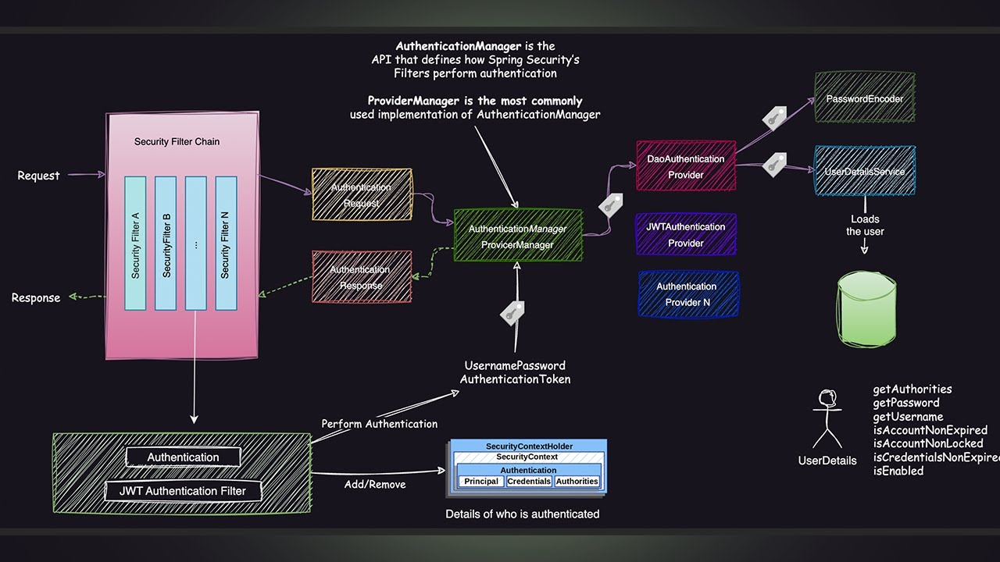

# Spring Security Documentation

## Introduction

This document describes the theoretical background and the practical implementation of authentication and authorization in the application. The implementation is based on **Spring Security**, **JWT**, and optional **OAuth2** providers.

The overall request flow and component interaction follow the standard Spring Security authentication pipeline, illustrated in the diagram below.



---

## Theoretical Background

### Authentication and Authorization

**Authentication** and **authorization** are closely related but conceptually distinct concerns in application security:

- **Authentication** is the process of verifying a user's identity. It answers: *"Who is making this request?"*
  - Mechanisms: email/password, JWT tokens, OAuth2 providers
  
- **Authorization** determines what an authenticated user is allowed to do. It answers: *"What is this user permitted to access?"*
  - Based on: roles, permissions, or authorities
  - **Note**: Authentication must occur before authorization can be evaluated

### Stateless vs. Stateful Authentication

Authentication systems can be categorized as **stateful** or **stateless**:

#### Stateful Authentication
- Server maintains session state
- Authentication data stored in server sessions
- Uses session identifiers (typically cookies)
- **Challenges**: scalability, session replication, sticky sessions

#### Stateless Authentication
- No server-side session storage
- Each request contains complete authentication information
- JWT-based authentication follows this model
- **Benefits**: 
  - Better scalability
  - RESTful principles alignment
  - Simplified horizontal scaling

### Why JWT Tokens Are Sent in Request Headers

JWTs are transmitted using the `Authorization` header with the `Bearer` scheme:

```http
Authorization: Bearer <jwt-token>
```

**Benefits of header-based authentication**:
- Headers carry request metadata naturally
- Authentication handled before application logic
- Avoids cookie pitfalls (implicit browser behavior, CSRF)
- Clean integration with API clients and frontend frameworks

### Token Storage Strategies

Client-side token storage options and their trade-offs:

| Storage Method | Pros | Cons |
|---|---|---|
| **Memory** | Strong XSS protection | Lost on page refresh |
| **LocalStorage** | Survives refreshes/restarts | XSS vulnerability |
| **HttpOnly Cookies** | XSS resistant | Requires CSRF mitigation |

We choose **localStorage** due to simplicity, but for future projects we might rethink this strategy. 

### CORS and Cross-Origin Requests

When frontend and backend are hosted on different origins, browsers enforce **CORS** rules.

**CORS configuration determines**:
- Which origins can make requests
- Which HTTP methods are permitted
- Which headers may be sent

> **Important**: Since JWT authentication uses the `Authorization` header, this header must be explicitly allowed in CORS configuration. Incorrect CORS setup can block authenticated requests entirely.

### JWT Structure and Claims

A JWT consists of three base64-encoded components:

```
header.payload.signature
```

1. **Header**: Token type and signing algorithm
2. **Payload**: Claims (statements about user/token)
   - Standard claims: `sub` (subject), `exp` (expiration), `iss` (issuer)
   - Custom claims: roles, user IDs, permissions
3. **Signature**: Ensures integrity and prevents tampering

> **Security**: Any modification to header or payload invalidates the signature

### Token Generation and Validation

#### Token Generation
1. Successful authentication occurs
2. Application constructs claims
3. Token signed using secret/key pair
4. Token returned to client

#### Token Validation (on every request)
1. Verify signature
2. Check expiration time
3. Validate time-based constraints
4. Evaluate relevant claims

> Only tokens passing **all** validation steps are accepted

### JWT and OAuth2 Integration

**OAuth2** delegates authentication to external identity providers (Google, Microsoft, etc.)

#### How it works:
1. OAuth2 handles user identity verification and consent
2. Application remains agnostic of user credentials  
3. After OAuth2 success → application issues its own JWT
4. JWT becomes primary authentication for subsequent API requests

**Benefits**:
- Compact, stateless authentication representation
- No credential management burden

---


## Practical Implementation (Spring Security)


### 1. Request and Servlet Entry Point

**Request Flow**:
```
Client Request → Spring Security Filter Chain → DispatcherServlet → Controller
```

- Requests **do not** directly reach controllers
- Must pass through Spring Security Filter Chain first
- Each filter performs specific security tasks
- DispatcherServlet handles routing only after security checks

### 2. Filter Failures and HTTP Status Codes

**When filters fail**:

| Status Code | Meaning | When It Occurs |
|---|---|---|
| **401 Unauthorized** | Authentication missing/invalid | No valid JWT token |
| **403 Forbidden** | Access denied | Valid auth, insufficient permissions |

#### Common HTTP Status Reference:
| Code | Status | Description |
|---|---|---|
| **200** | OK | Success |
| **201** | Created | Resource created |
| **400** | Bad Request | Client error |
| **401** | Unauthorized | Authentication required |
| **403** | Forbidden | Access denied |
| **404** | Not Found | Resource not found |
| **500** | Internal Server Error | Server error |

### 3. JWT Authentication Filter

The **JWT Authentication Filter** intercepts incoming requests and:

1. Extracts the `Authorization` header
2. Checks for JWT presence  
3. Validates token format and signature
4. If no token → request continues as **unauthenticated**

### 4. Authentication Manager and Providers

**Process Flow**:
1. Filter creates `Authentication` object (e.g., `UsernamePasswordAuthenticationToken`)
2. Authentication delegated to `AuthenticationManager`
3. Manager delegates to one or more `AuthenticationProviders`

#### Available Authentication Providers:

##### Email + Password Authentication
- Passwords stored as **hashes** (one-way function)
- Incoming password hashed and compared to stored hash
- **Never** store plaintext passwords

##### OAuth2 Authentication (Google, Microsoft)
**Setup Requirements**:
- Application registered in provider console
- Client ID and secret issued
- Redirect URIs configured:
  ```
  Dev:  http://localhost:8080/login/oauth2/code/google
  Prod: https://chat-lytics.com/api/login/oauth2/code/google
  ```

**Flow**:
1. Provider authenticates user
2. Redirects back with authorization code
3. Application exchanges code for access token

### 5. UserDetailsService

After provider selection, **UserDetailsService** loads user data.

#### UserDetails Interface
The user entity implements `UserDetails`, exposing:

```java
// Core user information
getUsername()
getPassword()
getAuthorities()  // Roles and permissions

// Account status checks
isAccountNonExpired()
isAccountNonLocked()
isCredentialsNonExpired()
isEnabled()
```

> **Security Principle**: Authorities define user roles and permissions following the **principle of least privilege**

### 6. SecurityContextHolder

#### Authentication Success Flow:
1. Authenticated `Authentication` object created
2. Stored in `SecurityContext`
3. Context held by `SecurityContextHolder`

#### SecurityContextHolder Functions:
- Stores authentication info for request duration
- Makes authenticated principal available app-wide
- Access via: `SecurityContextHolder.getContext().getAuthentication()`

#### Stateless Setup (JWT):
```
Request → JWT Validation → Context Reconstruction → Process → Context Cleared
```

- Context reconstructed on **every** request from JWT
- **No** server-side session storage
- Context automatically cleared after request

---

## Frontend Considerations

### Post-Login Optimization

After successful login:

#### **DO**: Cache User Data in Auth Context
```typescript
// Cache user-related data
interface User {
  id: string;
  email: string;
  credits: number;
  roles: string[];
}

const authContext = {
  user: userData,     // Cached user info
  token: jwtToken,    // Authentication token
  refreshUser: () => // Function to update cache
}
```

#### **DON'T**: Refetch on Every Navigation
- Avoid fetching user metadata on every page change
- Prevents unnecessary API calls
- Improves performance and user experience

### Key Principle
> **Token presence** = Authentication state  
> **Cached user data** = UX state and permissions